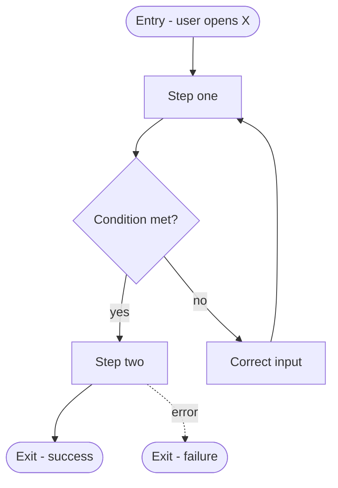

# <Title>

## Purpose

<!-- 1-3 sentences. What user goal does this flow serve, and why does it exist?
     Write it so an agent reading only this section knows whether to keep reading. -->

## Actors and systems

| Actor / system | Role in this flow |
| --- | --- |
| <end-user> | <initiates, provides input> |
| <api> | <validates, persists> |

## Diagram

<!-- Node IDs MUST match the Node dictionary below. Keep labels short; details go in the table. -->

## Node dictionary

<!-- The machine-readable contract. One row per node ID in the diagram. -->

| ID | Kind | Label | What happens | Owner surface |
| --- | --- | --- | --- | --- |
| IN | entry | Entry - user opens X | <trigger condition> | <screen / endpoint> |
| F1 | step | Step one | <action + data touched> | <screen / endpoint> |
| D1 | decision | Condition met? | <rule evaluated> | <where evaluated> |
| F2 | step | Step two | <action> | <screen / endpoint> |
| F3 | step | Correct input | <recovery action> | <screen / endpoint> |
| OUT | exit | Exit - success | <post-state> | — |
| ERR | exit | Exit - failure | <post-state> | — |

Kinds: `entry`, `step`, `decision`, `exit`, `subflow`.

## Decision rules

| Decision | Branch | Condition (explicit) |
| --- | --- | --- |
| D1 | yes | <precise, testable condition> |
| D1 | no | <precise, testable condition> |

## Failure paths and edge cases

- **<Case>** — <what the user sees, what the system does, where the flow resumes.>

## Open questions

- [ ] <Unresolved decision that blocks implementation.>

## Changelog

| Date | Version | Change |
| --- | --- | --- |
| <YYYY-MM-DD> | 0.1.0 | Initial draft. |
