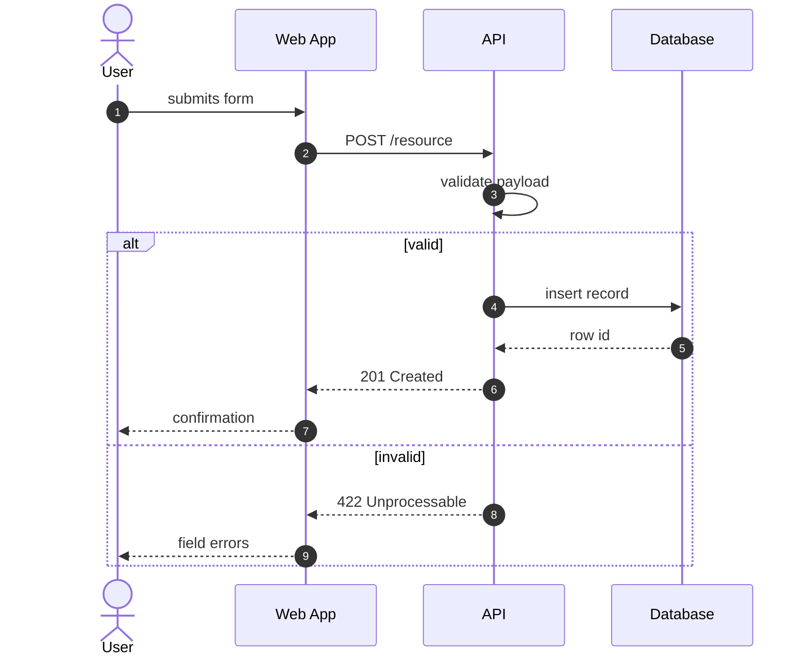

# <Title> — sequence

## Purpose

<!-- 1-3 sentences. Which step of which flow this expands, and what contract it pins down. -->

## Diagram

<!-- Participant aliases MUST match the Participants table. Keep `autonumber` so steps are citable. -->

## Participants

| Alias | Name | Kind | Responsibility |
| --- | --- | --- | --- |
| U | User | actor | <provides input> |
| W | Web App | client | <renders, validates locally> |
| A | API | service | <authoritative validation, persistence> |
| D | Database | store | <durable state> |

## Step contract

<!-- The machine-readable contract. Numbers match `autonumber` in the diagram. -->

| # | From → To | Message | Payload / shape | Notes |
| --- | --- | --- | --- | --- |
| 1 | U → W | submits form | <fields> | <...> |
| 2 | W → A | POST /resource | <request body> | <auth header> |
| 3 | A → A | validate payload | — | <rules referenced> |
| 4 | A → D | insert record | <columns> | <transaction boundary> |
| 5 | D → A | row id | <id> | — |
| 6 | A → W | 201 Created | <response body> | — |
| 7 | W → U | confirmation | — | <redirect target> |

## Failure modes

| Step | Failure | Response | Retry / recovery |
| --- | --- | --- | --- |
| 2 | <network timeout> | <client error state> | <retries, backoff> |
| 4 | <constraint violation> | <409 Conflict> | <no retry, surface to user> |

## Non-functional notes

- **Timeouts** — <per hop budget.>
- **Retries** — <policy, and whether the operation is safe to repeat.>
- **Auth** — <what is checked, where.>

## Open questions

- [ ] <Unresolved decision.>

## Changelog

| Date | Version | Change |
| --- | --- | --- |
| <YYYY-MM-DD> | 0.1.0 | Initial draft. |
