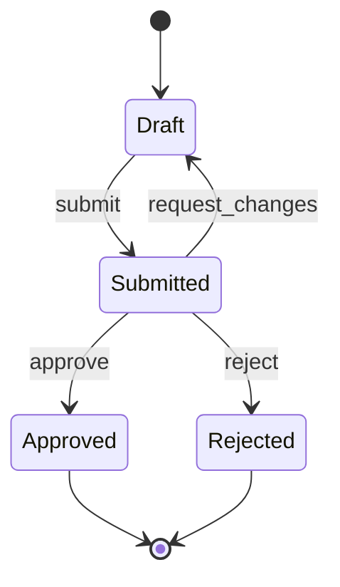

# <Title> — states

## Purpose

<!-- 1-3 sentences. Which entity or surface this machine governs and what invariant it protects. -->

## Diagram

<!-- State names MUST match the State dictionary. Transition labels MUST match the event names. -->

## State dictionary

| State | Meaning | Invariants (always true here) | Visible to user as | Terminal |
| --- | --- | --- | --- | --- |
| Draft | <meaning> | <e.g. not visible to reviewers> | <UI label / badge> | no |
| Submitted | <meaning> | <e.g. immutable payload> | <UI label> | no |
| Approved | <meaning> | <...> | <UI label> | yes |
| Rejected | <meaning> | <...> | <UI label> | yes |

## Transition table

<!-- The machine-readable contract. Every arrow in the diagram appears here exactly once. -->

| From | Event | Guard (must be true) | To | Side effects |
| --- | --- | --- | --- | --- |
| Draft | submit | <validation passes> | Submitted | <notification, audit entry> |
| Submitted | approve | <actor has role reviewer> | Approved | <...> |
| Submitted | request_changes | <comment present> | Draft | <...> |
| Submitted | reject | <actor has role reviewer> | Rejected | <...> |

## Illegal transitions

<!-- Explicit negatives stop agents from inventing shortcuts. -->

- `Draft -> Approved` — <why it must not exist.>
- `Approved -> *` — terminal, no outbound transitions.

## Timeouts and automatic transitions

| From | Trigger | After | To |
| --- | --- | --- | --- |
| <Submitted> | <no reviewer action> | <7 days> | <Draft> |

## Open questions

- [ ] <Unresolved decision.>

## Changelog

| Date | Version | Change |
| --- | --- | --- |
| <YYYY-MM-DD> | 0.1.0 | Initial draft. |
